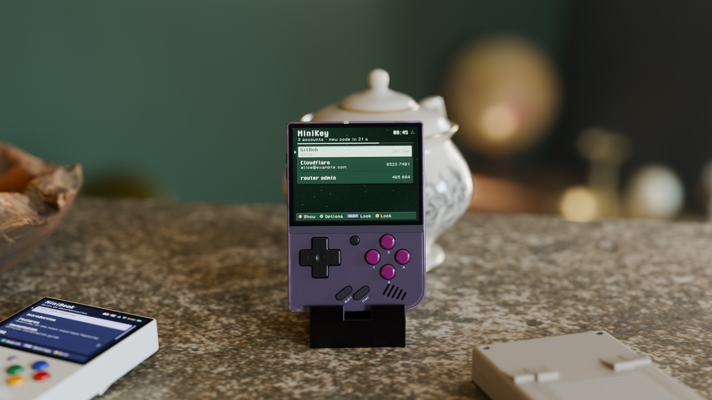
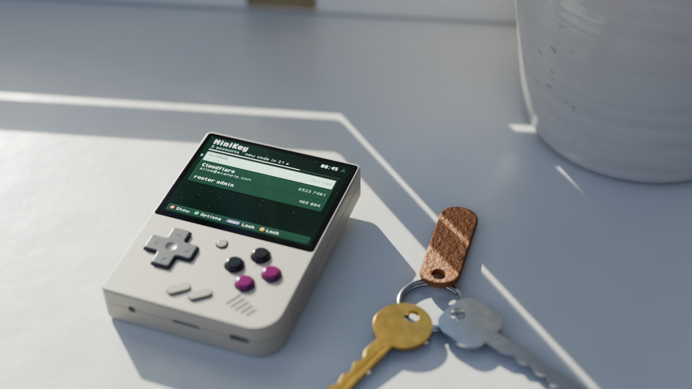

<p align="center"></p>

[](https://github.com/zakijss/MiniKey/actions/workflows/ci.yml)
[](https://github.com/zakijss/MiniKey/releases)
[](LICENSE)

# MiniKey

Your 2FA codes (TOTP) on a Miyoo Mini Plus, sealed with the device key and a code you press on the buttons. Part of [MiniDeck](https://github.com/zakijss/MiniDeck).

- Imports `otpauth://` links exported from Ente Auth, Aegis or 2FAS, then erases the plain file.
- An unlock code of 6 to 16 presses of the d-pad and A, B, X, Y; growing waits after wrong codes, kept across restarts.
- Locks itself after three minutes untouched; **Y > Auto-lock** sets 1, 3, 5 or 10 minutes, and Options also hides the next code or sorts the accounts by name.
- Corrects the codes when the device's clock is off, checked against an HTTPS server.


<p align="center"></p>

## Using it

Copy the export into `App/MiniKey/` or the root of the card and open MiniKey; the first time, choose the unlock code. **A** shows a code; **Y** imports more accounts, changes the code or removes an account.

The card alone opens nothing: the accounts need the key in the device's internal flash and your code. Keep your 2FA backups elsewhere too.

## Install

- **MiniMart:** open [MiniMart](https://github.com/zakijss/MiniMart), then **Apps > MiniKey**. It checks the download and keeps your settings on updates.
- **Zip:** download `minikey-VERSION.zip` from [Releases](https://github.com/zakijss/MiniKey/releases/latest), unzip it onto the root of the SD card, and restart.
- **Every MiniDeck app at once:** [minideck-all.zip](https://github.com/zakijss/MiniDeck/releases/latest/download/minideck-all.zip).

## Requirements

A Miyoo Mini Plus on Onion OS 4.4, with Wi-Fi. Other devices and firmwares aren't supported.

## Building

```sh
make check                     # vet, tests, scripts
make package VERSION=1.0.0     # dist/: the release zip, app.json, SHA256SUMS
make deploy HOST=root@miyoo    # build and copy to a device over SSH
```

Go runs in Docker unless you pass `GO=go` (Go 1.27). The interface, themes and networking come from the [MiniDeck library](https://github.com/zakijss/MiniDeck); see its [development notes](https://github.com/zakijss/MiniDeck/blob/main/docs/DEVELOPMENT.md) and [contributing guide](https://github.com/zakijss/MiniDeck/blob/main/CONTRIBUTING.md).

## License

[MIT](LICENSE). Third-party components are listed in [NOTICE](NOTICE). Not made by or affiliated with Miyoo.
