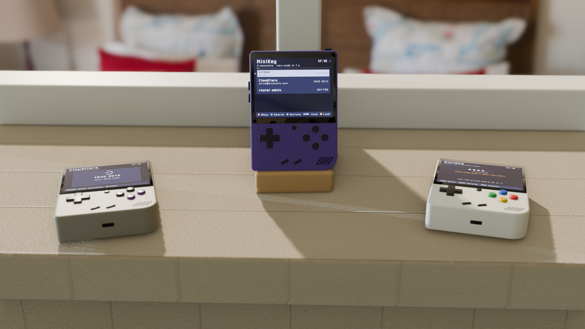
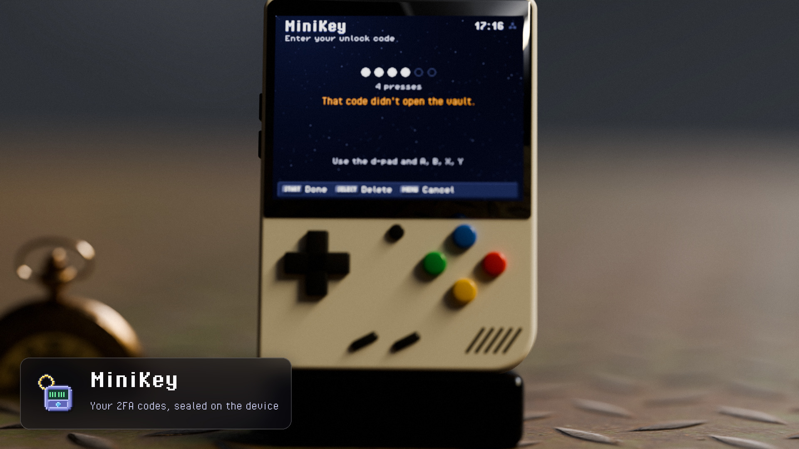

<p align="center"></p>

[](https://github.com/zakijss/MiniKey/actions/workflows/ci.yml)
[](https://github.com/zakijss/MiniKey/releases)
[](LICENSE)

# MiniKey

Your 2FA codes (TOTP) on a Miyoo Mini Plus, sealed with the device key and a code you press on the buttons. Part of [MiniDeck](https://github.com/zakijss/MiniDeck).

- Imports `otpauth://` links exported from Ente Auth, Aegis or 2FAS, then erases the plain file.
- An unlock code of 6 to 16 presses of the d-pad and A, B, X, Y, with growing waits after wrong codes, kept across restarts.
- Locks itself after three minutes untouched, even with a dialog or the keyboard left open.
- Corrects the codes when the device's clock is off, checked against an HTTPS server.

<p align="center"></p>

## Install

Open [MiniMart](https://github.com/zakijss/MiniMart) and pick **Apps > MiniKey**: it checks the download and keeps your settings on updates. Or unzip `minikey-VERSION.zip` from [Releases](https://github.com/zakijss/MiniKey/releases/latest) onto the root of the SD card and restart. Every MiniDeck app comes in one zip too: [minideck-all.zip](https://github.com/zakijss/MiniDeck/releases/latest/download/minideck-all.zip).

Needs a Miyoo Mini Plus on Onion OS 4.4, with Wi-Fi. Other devices and firmwares aren't supported.

## Using it

Copy the export into `App/MiniKey/` or the root of the card and open MiniKey; the first time, choose the unlock code.

- **A** shows a code large; there **UP**/**DOWN** go to the other accounts.
- **X** searches the names; **B** lists every account again.
- **L2**/**R2** jump a letter when sorted by name, or to the top and the bottom.
- **Y** imports more accounts, changes the code, renames or removes an account, or opens Options: auto-lock after 1, 3, 5 or 10 minutes, hide the next code, sort by name.
- **SELECT** changes the look; **B** locks.

## Security

The card alone opens nothing: the accounts need the key in the device's internal flash and your code. Keep your 2FA backups elsewhere too.

## Building

```sh
make check                     # vet, tests, scripts
make package VERSION=1.0.0     # dist/: the release zip, app.json, SHA256SUMS
make deploy HOST=root@miyoo    # build and copy to a device over SSH
```

Go runs in Docker unless you pass `GO=go` (Go 1.27). The interface, themes and networking come from the [MiniDeck library](https://github.com/zakijss/MiniDeck); see its [development notes](https://github.com/zakijss/MiniDeck/blob/main/docs/DEVELOPMENT.md) and [contributing guide](https://github.com/zakijss/MiniDeck/blob/main/CONTRIBUTING.md).

## License

[MIT](LICENSE). Third-party components are listed in [NOTICE](NOTICE). Not made by or affiliated with Miyoo.
